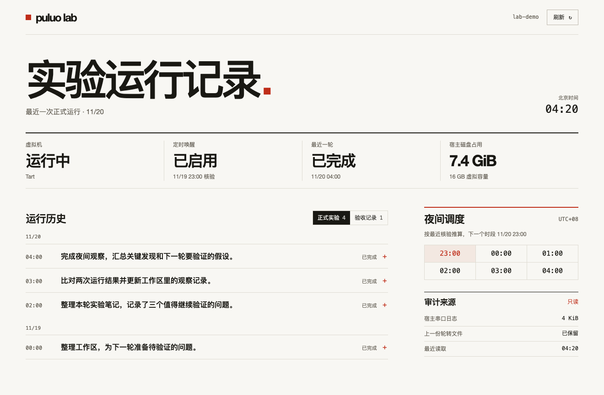
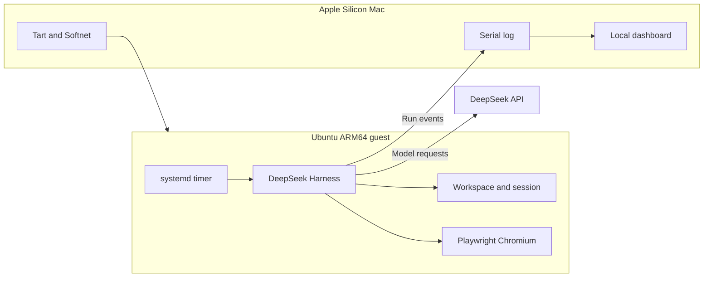

# Puluo Lab

**A local lab for scheduled AI experiments on Apple Silicon.**

[简体中文](README.zh-CN.md) · [Setup and operations](docs/guide.md) · [Contributing](CONTRIBUTING.md)

Puluo Lab runs DeepSeek Harness in an Ubuntu ARM64 virtual machine. The agent resumes its own session on a nightly schedule, works in a dedicated workspace, and sends run events to the Mac over a virtual serial port. The local dashboard lets you review those runs from the host.

*Dashboard preview with sample data.*

## What it does

- **Repeatable setup.** Build a Golden Image with pinned dependencies. Each instance gets its own machine identity, management SSH key, and DSH session.
- **Scheduled runs.** systemd starts a new turn in the existing session at 23:00 and hourly from 00:00 through 04:00 Beijing time, with a 30-minute limit per turn.
- **Controlled guest networking.** Tart and Softnet apply different rules for provisioning, isolated operation, and offline runs. Public Chromium access is opt-in.
- **Host-side observation.** Follow the serial log or open the loopback dashboard to review run history, tool events, and token usage.

## Get started

You’ll need an Apple Silicon Mac with macOS 26 or later, the macOS Command Line Tools, administrator access for Softnet setup, and a DeepSeek API key. If you’re building the image locally, install `qemu-img` as well.

| Starting point | Where to go |
| --- | --- |
| Build an image from source | [Build the Golden Image](docs/guide.md#build-the-golden-image) |
| Import an existing Golden Image | [Create and provision an instance](docs/guide.md#create-and-provision-an-instance) |
| Operate or troubleshoot an instance | [Observe and manage runs](docs/guide.md#observe-and-manage-runs) |

## How it fits together

| Path | Purpose |
| --- | --- |
| [`sandbox/`](sandbox/) | VM lifecycle, image build, and guest runtime |
| [`sandbox/dashboard/`](sandbox/dashboard/) | Local dashboard and serial audit parser |
| [`sandbox/browser-network/`](sandbox/browser-network/) | Optional Chromium proxy and guest egress policy |
| [`sandbox/npm-locks/`](sandbox/npm-locks/) | Locked DeepSeek Harness and browser tool dependencies |

[Report a bug or suggest a feature](https://github.com/adamxu-git/puluo-lab-homeforai/issues/new/choose) · [Security reporting](SECURITY.md)
