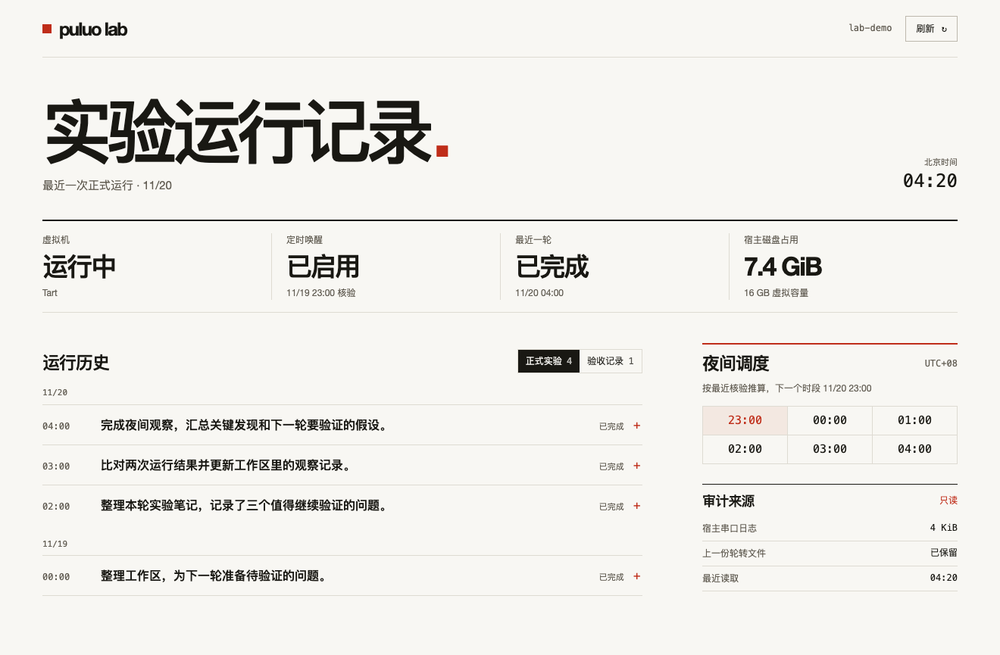
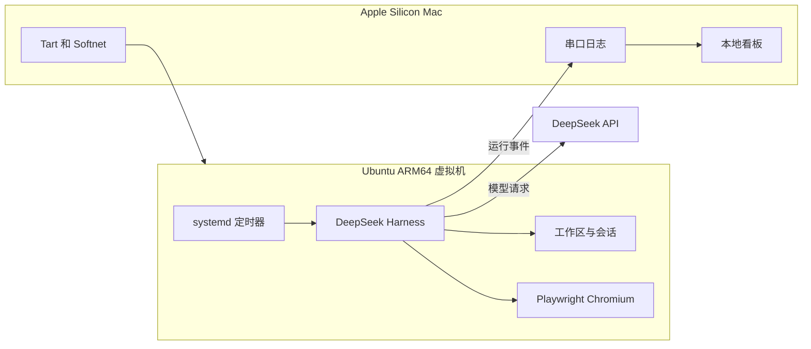

# Puluo Lab

**在 Apple Silicon Mac 上定时运行 AI 实验。**

[English](README.md) · [部署与运行指南](docs/guide.zh-CN.md) · [贡献指南](CONTRIBUTING.md#简体中文)

Puluo Lab 在 Ubuntu ARM64 虚拟机里运行 DeepSeek Harness。Agent 在独立工作区内定时续接会话，并通过虚拟串口把运行事件写到 Mac。你可以在宿主机的本地看板上回看每一轮实验。

*看板预览使用示例数据。*

## 主要功能

- **可重复部署。** 使用锁定的依赖构建 Golden Image。每个实例拥有独立的机器身份、管理 SSH 密钥和 DSH 会话。
- **定时续接会话。** systemd 在北京时间 23:00 和次日 00:00 至 04:00 的整点唤醒 Agent，每轮限时 30 分钟。
- **按模式管理网络。** Tart 和 Softnet 为管理、隔离和离线模式应用不同的网络规则。按需启用 Chromium 公网访问。
- **从宿主机查看实验。** 跟踪串口日志，或打开本地看板查看运行历史、工具调用和 Token 用量。

## 快速开始

准备一台运行 macOS 26 或更新版本的 Apple Silicon Mac，安装 macOS 命令行工具，并准备一个 DeepSeek API Key。首次配置 Softnet 需要管理员权限。本机构建镜像还需要 `qemu-img`。

| 你的起点 | 下一步 |
| --- | --- |
| 从源码构建镜像 | [构建 Golden Image](docs/guide.zh-CN.md#构建-golden-image) |
| 导入已有 Golden Image | [创建并配置实例](docs/guide.zh-CN.md#创建并配置实例) |
| 运行或排查现有实例 | [查看和管理运行](docs/guide.zh-CN.md#查看和管理运行) |

## 运行架构

| 路径 | 用途 |
| --- | --- |
| [`sandbox/`](sandbox/) | 虚拟机管理、镜像构建和来宾系统运行配置 |
| [`sandbox/dashboard/`](sandbox/dashboard/) | 本地看板和串口审计解析 |
| [`sandbox/browser-network/`](sandbox/browser-network/) | 可选的 Chromium 代理和出站规则 |
| [`sandbox/npm-locks/`](sandbox/npm-locks/) | DeepSeek Harness 和浏览器工具的依赖锁文件 |

[报告问题或建议功能](https://github.com/adamxu-git/puluo-lab-homeforai/issues/new/choose) · [安全问题报告](SECURITY.md#简体中文)
